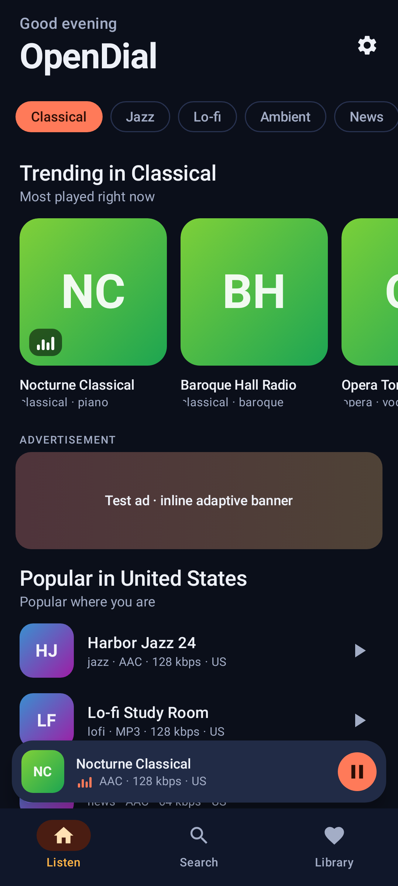
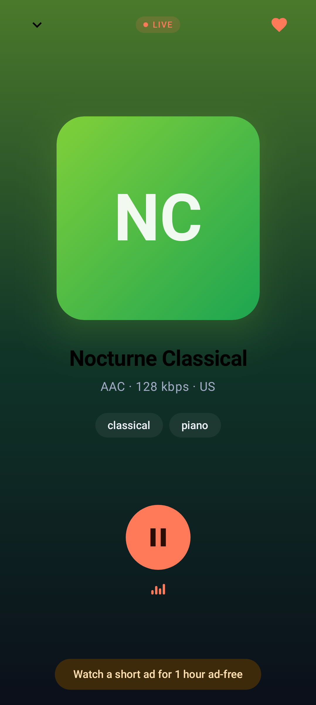
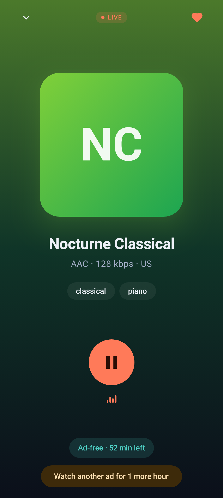
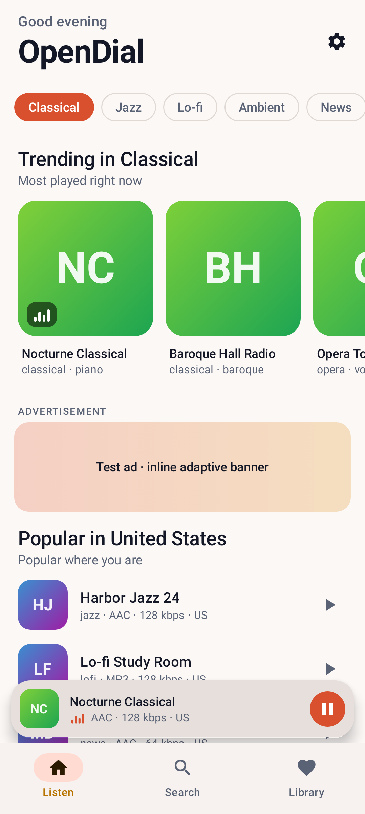

# OpenDial: an ad-supported radio app (Android, Kotlin, Compose)

[](https://github.com/techsavvysenior/android-ad-supported-radio/actions/workflows/ci.yml)

A free internet radio app paid for by ads, the business model of most radio and podcast apps.
It plays real public stations from the open [Radio Browser](https://www.radio-browser.info)
directory, keeps playing in the background, and shows ads the way listeners put up with: one
labelled banner in the feed, interstitials only between stations and never more than every five
minutes, and a rewarded ad that buys an hour with no ads at all.

<p>
  
  
  
  
</p>

<sub>Rendered from the real Compose screens by the screenshot tests, with sample stations and a
placeholder where the live banner goes. CI updates them on every change.</sub>

## What it shows

| | |
|---|---|
| Ads | Google Mobile Ads **Next-Gen SDK** (AdMob and Ad Manager), inline adaptive banner, interstitial, rewarded |
| Mediation | **AppLovin** through AdMob mediation, filling when Google's demand doesn't |
| Consent | Google **UMP** first; nothing that serves ads or measures installs starts before it allows it |
| Attribution | **AppsFlyer** SDK 7 and the **Meta** SDK, with the same events under each one's standard names |
| Playback | Media3 `MediaSessionService` with ExoPlayer: background audio, notification and lock-screen controls, HLS |
| UI | Jetpack Compose, Material 3, light and dark, edge to edge, a station-colored player |

The decisions that make or break an ad-supported app are plain Kotlin in `:core`, with no Android
in them, and tested on the JVM:

- **When an interstitial may show.** Only on a station switch, not in the first 2 minutes, at least
  5 minutes and 3 switches apart, never during an ad-free pass. The stream pauses under the ad.
  [InterstitialPolicy](core/src/main/kotlin/com/example/opendial/core/ads/InterstitialPolicy.kt), [ADR 3](docs/adr/0003-interstitials-only-at-station-switches.md)
- **What a rewarded ad buys.** 60 minutes ad-free, stacking to 3 hours, granted only on the reward
  callback. [AdFreePass](core/src/main/kotlin/com/example/opendial/core/ads/AdFreePass.kt), [ADR 4](docs/adr/0004-rewarded-ad-free-pass.md)
- **What starts when.** Consent and AppsFlyer's session signal can arrive in any order; each SDK
  starts once, and only after consent. [StartupGate](core/src/main/kotlin/com/example/opendial/core/startup/StartupGate.kt), [ADR 2](docs/adr/0002-consent-before-any-sdk.md)
- **Which events go where.** One mapping to AppsFlyer and Meta standard events, no personal data,
  pinned to the SDKs' constants by a test. [EventMapping](core/src/main/kotlin/com/example/opendial/core/analytics/AnalyticsEvent.kt), [table](docs/ads-and-events.md#events)

## Quality

| | Count | Command |
|---|---:|---|
| Core tests (pacing, pass, events, start order, stations) | 40 | `./gradlew :core:test` |
| App tests (SDK constants, screenshots) | 8 | `./gradlew :app:testDebugUnitTest` |
| Use cases, each traced to tests or a manual check | 13 | `node scripts/traceability.mjs --check` |

CI runs all of it plus Android lint and a debug build with every SDK on the classpath.

- [Ads and events](docs/ads-and-events.md): placements, networks, the event table, start order
- [Use cases](docs/use-cases.md) and the generated [traceability matrix](docs/traceability.md)
- [Test plan](docs/test-plan.md), including the on-device checks for what CI can't reach
- [Privacy notes](docs/privacy.md)
- ADRs: [Next-Gen SDK](docs/adr/0001-next-gen-ads-sdk.md), [consent first](docs/adr/0002-consent-before-any-sdk.md), [interstitial pacing](docs/adr/0003-interstitials-only-at-station-switches.md), [ad-free pass](docs/adr/0004-rewarded-ad-free-pass.md), [config](docs/adr/0005-config-from-gradle-properties.md)

## Run it

Android Studio with JDK 21, a phone or emulator on Android 8.0 (API 26) or later.

```bash
chmod +x gradlew   # the executable bit isn't kept by every git client
./gradlew :app:installDebug
```

That runs on Google's demo ad units with attribution off. To use real accounts, put these in
`~/.gradle/gradle.properties` (never in the repo):

```properties
opendial.admob.appId=ca-app-pub-XXXXXXXXXXXXXXXX~YYYYYYYYYY
opendial.ads.bannerUnit=...
opendial.ads.interstitialUnit=...
opendial.ads.rewardedUnit=...
opendial.appsflyer.devKey=...
opendial.meta.appId=...
opendial.meta.clientToken=...
```

Leave the units blank and set `opendial.ads.network=admanager` to run on Ad Manager's demo units.
AppLovin is turned on in the AdMob console (mediation group plus the AppLovin SDK key); the app
needs nothing more than the adapter it already ships.

## Layout

```
core/   Plain Kotlin: stations and queries, ad pacing, the ad-free pass, event mapping, start-up gate
app/    Compose UI, Media3 playback service, consent, ads, AppsFlyer and Meta wiring
docs/   Ads and events, use cases, traceability, test plan, privacy, ADRs, screenshots
```

## Limits

This is a sample, not a published app.

- CI doesn't serve live ads or check mediation fill. Those are on-device checks in the test plan.
- No server-side verification of rewards; fine for an ad-free hour, not for anything with cash value.
- No US-state "do not sell" screen wired to `AppLovinPrivacySettings`; see the privacy notes.
- Stations come from a community directory. Only working HTTPS streams are shown, but a station can
  still go offline between the directory's checks.

## Versions

Checked November 2026: AGP 9.5.1, Gradle 9.9.1, Kotlin 2.4.21, Compose BOM 2026.11.01, Media3
1.11.1, GMA Next-Gen SDK 1.7.0, AppLovin adapter 13.7.0.0, AppsFlyer 7.0.4, Meta SDK 19.0.1,
OkHttp 5.5.1, Coil 3.6.3, Robolectric 4.18.1, Roborazzi 1.77.0. compileSdk 37.2, targetSdk 36,
minSdk 26.

## License

MIT
